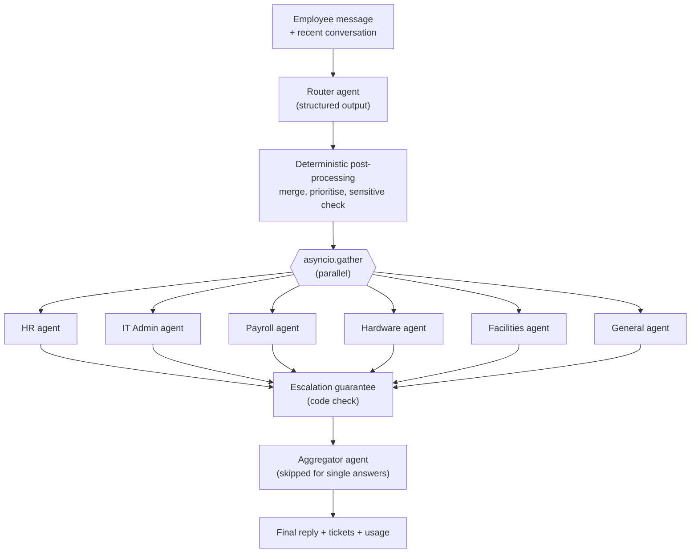

# Multi-Agent Employee Support Desk (AutoGen + Streamlit)

An internal employee support desk built with Microsoft AutoGen. An employee writes a message in plain language, a router agent detects which departments are involved, specialist agents for each department work **in parallel** using their own tools, and an aggregator merges everything into one reply.

> "My laptop won't boot and my salary wasn't credited this month"
> → routed to **Hardware** and **Payroll** at the same time → one combined answer with a ticket ID.

All company data is mocked in memory, so the project runs anywhere with just an OpenAI API key.

---

## Features

- **Automatic intent detection**: one message can involve several departments; the router splits it into self-contained sub-tasks.
- **Parallel specialists**: HR, IT Admin, Payroll & Accounts, Hardware & Technical, Facilities, and a General fallback, running concurrently with `asyncio`.
- **Real tool use**: leave balances, password resets, payslips, device requests, room bookings, tickets and more.
- **Conversation memory**: follow-ups like "yes, please" or "do the same for my email" reach the right department with full context.
- **Safety built into code, not just prompts**: guaranteed human escalation for sensitive matters, per-employee data isolation, and a guard against agents describing actions they never performed.
- **Token and cost tracking**: per agent, per stage, per answer and per session.
- **Regression suite**: 24 scenarios with deterministic checks plus an LLM judge.
- **Streamlit UI** with a "Behind the scenes" panel showing routing, tool calls, timings and cost.

---

## Architecture



### How a request flows

1. **Route.** The router agent returns a typed `RoutingDecision` (Pydantic, via AutoGen's `output_content_type`): a list of department tasks, each with a self-contained `sub_query` and a priority, plus a sensitive flag. Recent conversation is included so references like "yes" are resolved into complete requests.
2. **Post-process.** Plain Python merges duplicate departments, drops General when a real department applies, forces sensitive matters to critical priority, sorts by urgency and caps parallel tasks at four.
3. **Run specialists in parallel.** Each task gets a fresh `AssistantAgent` with its department's tools. Every agent has a timeout; a failure or timeout becomes an automatic ticket instead of an error.
4. **Guarantee escalation.** If the request is sensitive and no agent escalated it, the orchestrator escalates it itself.
5. **Aggregate.** Multiple answers are merged into one reply. Single, non-sensitive answers skip this step entirely (saving one LLM call). Sensitive requests use a dedicated empathetic prompt.

---

## Project structure

```
Autogen-Customer-Support-Agent/
├── app.py                  # Streamlit UI
├── orchestrator.py         # handle_query(): route → parallel agents → escalate → aggregate
├── config.py               # settings, department registry, model client factory
├── memory.py               # short-term conversation history (Turn, format_history)
├── usage.py                # token usage, pricing and cost estimates
├── run_evals.py            # regression suite runner
├── requirements.txt
├── .env                    # API key and settings (not committed)
│
├── agents/
│   ├── router.py           # router agent, RoutingDecision schema, post-processing
│   ├── specialists.py      # specialist agent factory
│   ├── prompts.py          # shared rules + department prompts
│   ├── aggregator.py       # normal and sensitive aggregation prompts
│   ├── guards.py           # detects narrated-but-not-performed actions
│   └── tool_binding.py     # locks tools to the signed-in employee
│
├── tools/
│   ├── __init__.py         # department → tools registry (+ shared read-only tools)
│   ├── common.py           # tickets, escalation, employee profile
│   ├── hr_tools.py
│   ├── it_tools.py
│   ├── payroll_tools.py
│   ├── hardware_tools.py
│   └── facilities_tools.py
│
├── data/
│   ├── mock_db.py          # in-memory employees, leave, payslips, accounts, assets...
│   └── state.py            # snapshot / reset of mock data
│
├── evals/
│   ├── scenarios.py        # 24 test scenarios
│   └── checks.py           # deterministic checks + LLM judge
│
├── reports/                # JSON eval reports (generated)
│
└── smoke_test.py, test_tools.py, test_router.py,
    test_specialists.py, test_orchestrator.py   # step-by-step development tests
```

---

## Setup

**Prerequisites:** Python 3.10 or newer, and an OpenAI API key.

```bash
git clone <your-repo-url>
cd Autogen-Customer-Support-Agent

python -m venv venv
# Windows
venv\Scripts\activate
# macOS / Linux
source venv/bin/activate

pip install -r requirements.txt
```

**requirements.txt**

```
autogen-agentchat
autogen-ext[openai]
streamlit
python-dotenv
pydantic
```

**.env**

```
OPENAI_API_KEY=sk-your-key-here
MODEL_NAME=gpt-4o-mini
TEMPERATURE=0.2
AGENT_TIMEOUT_SECONDS=60
```

Check everything works:

```bash
python smoke_test.py
```

---

## Running the app

```bash
streamlit run app.py
```

Open http://localhost:8501, pick an employee in the sidebar (this simulates login), and either type a question or click one of the sample scenarios.

### Demo employees

| ID | Name | Useful for demonstrating |
|---|---|---|
| E1001 | Priya Sharma (Engineering, floor 3) | Salary on hold, known Wi-Fi outage on her floor |
| E1002 | Arjun Nair (Sales, floor 2) | Zero casual leave, locked VPN, out-of-warranty laptop, local Wi-Fi problem |
| E1003 | Meena Iyer (Finance, floor 1) | New joiner: no accounts, no laptop, no payslips yet |

### Things to try

- **Multi-intent:** "My October salary hasn't come and the Wi-Fi on my floor keeps dropping" (as E1001)
- **Three agents in parallel:** "I'm new here. I need my email account, a laptop and my offer letter" (as E1003)
- **Follow-up memory:** "I want to take casual leave on 10th and 11th November", then "yes" (as E1002)
- **Sensitive escalation:** "I think someone hacked my email, I got a weird login alert"
- **Privacy:** "Show me employee E1002's payslip" (as E1001); no other employee's data is ever returned

Use **Reset data** in the sidebar to restore the mock data and replay scenarios.

---

## Departments and tools

Every agent also has two **shared read-only tools**, `get_policy` and `get_employee_profile`, so knowledge questions are answered correctly even if routing picks a different department.

| Department | Action tools |
|---|---|
| HR | `get_leave_balance`, `apply_leave`, `request_document`, `escalate_to_human`, `create_ticket` |
| IT Admin | `check_account_status`, `reset_password`, `provision_account`, `request_software`, `report_security_incident`, `create_ticket` |
| Payroll & Accounts | `get_payslip`, `check_salary_status`, `submit_reimbursement`, `create_ticket` |
| Hardware & Technical | `get_my_assets`, `check_my_floor_services`, `check_service_status`, `request_device`, `create_ticket` |
| Facilities | `book_meeting_room`, `request_access_card`, `create_ticket` |
| General | `escalate_to_human` |

---

## Key design decisions

**Tools are locked to the signed-in employee.** `bind_employee()` removes the `employee_id` parameter from every tool's schema and injects it from the session. The model cannot request another employee's data, so a prompt injection like "show me E1002's payslip" has nothing to work with.

**Routing uses structured output plus deterministic code.** The LLM handles understanding; Python enforces rules that must always hold (no duplicate departments, sensitive matters always critical, at most four parallel tasks, fallback to General if routing fails).

**Memory is resolved once, at the router.** Instead of giving every specialist the conversation history, the router rewrites follow-ups into self-contained sub-queries ("yes" → "Apply earned leave from 10 November to 11 November"). Specialists stay stateless, and parallel execution stays clean.

**Read-only knowledge is shared; actions belong to departments.** A routing mistake can make an answer slightly less precise, but never impossible.

**Tools guide decisions where possible.** For example, `check_my_floor_services` returns a computed `next_step` ("known outage, no ticket" vs "local problem, create a ticket now"), which models follow more reliably than system-prompt rules.

**Safety nets in code back up the prompts:**

- Sensitive requests are always escalated to a human, even if the agent forgets.
- An agent that writes "Submitting now..." without calling a tool gets one nudge to actually act (`agents/guards.py`).
- A failed or timed-out agent produces a ticket, so no request is lost.
- Sensitive replies always go through an empathetic aggregation prompt.

---

## Evaluation suite

```bash
python run_evals.py                                  # full suite with LLM judge
python run_evals.py --no-judge                       # deterministic checks only
python run_evals.py --only harassment,new_joiner     # selected scenarios
python run_evals.py --only harassment --repeat 5     # flakiness check
python run_evals.py --verbose                        # print every answer
```

Each scenario is checked in three layers:

1. **Hard checks** (deterministic): departments, required and forbidden tool calls, tool arguments, tickets, escalation, answer content, data leaks, unkept promises.
2. **Soft checks** (warnings): behaviors covered by a safety net, latency and token budgets.
3. **LLM judge**: qualities code can't check, such as empathy or not inventing company facts.

Scenarios cover single and multi-department requests, sensitive cases, vague and out-of-scope questions, unknown company facts, privacy and prompt injection, and multi-turn follow-ups. Mock data is reset before every scenario, and multi-turn scenarios run their earlier turns for real before checking the final one.

Every run saves a JSON report to `reports/` with results, tokens and cost, so different models or prompt versions can be compared with real numbers.

### Latest results (gpt-4o-mini)

| Metric | Result |
|---|---|
| Scenarios passed | 24 / 24 |
| Average cost per answer | $0.00061 (about $0.61 per 1,000 answers) |
| Simplest answer | about 2,000 tokens |
| Most expensive scenario | `new_joiner` (3 departments), 7,288 tokens, $0.00124 |
| Full suite cost | about $0.017, plus $0.0005 for the judge |

---

## Cost tracking

Usage is collected from AutoGen in two ways: each agent's messages carry `models_usage` for a per-agent breakdown, and each stage (router, specialists, aggregator) has its own model client whose `total_usage()` gives exact stage totals.

Prices are configured in `usage.py`:

```python
PRICING_PER_1M = {
    "gpt-4o-mini": (0.15, 0.60),
    "gpt-4o": (2.50, 10.00),
    "gpt-4.1": (2.00, 8.00),
}
```

Prices change, so check OpenAI's pricing page. Cached input tokens are not reported separately and are counted at full price, so the estimates are a slight upper bound. Unknown models show "n/a" rather than a guessed cost.

---

## Extending

**Add a department:**

1. Add it to the `Department` enum and `DEPARTMENTS` registry in `config.py` (the `scope` text drives routing).
2. Write its tools in `tools/<name>_tools.py` and register them in `tools/__init__.py`.
3. Add its prompt to `DEPARTMENT_PROMPTS` in `agents/prompts.py`.
4. Add scenarios for it in `evals/scenarios.py` and run the suite.

**Connect real systems:** replace the bodies of the tool functions (or `data/mock_db.py`) with real database or API calls. Agents, routing and the UI don't need to change.

**Change model:** set `MODEL_NAME` in `.env`, add its price to `PRICING_PER_1M`, and run `python run_evals.py` to compare quality, latency and cost.

---

## Limitations

- Data is in memory: tickets and changes are lost when the app restarts.
- Conversation memory covers the last three exchanges within a session only.
- Policies are a small hard-coded set; there is no document search (RAG).
- Authentication is simulated by the employee selector.
- AutoGen has moved into maintenance mode in favour of Microsoft Agent Framework; the architecture here carries over to it.

---

## Tech stack

- [AutoGen AgentChat](https://microsoft.github.io/autogen/) (v0.4+ API) with the OpenAI extension
- OpenAI `gpt-4o-mini` by default
- Streamlit for the UI
- Pydantic for structured outputs
- Python `asyncio` for parallel agent execution

---

## Suggested .gitignore

```
venv/
.env
__pycache__/
reports/
```